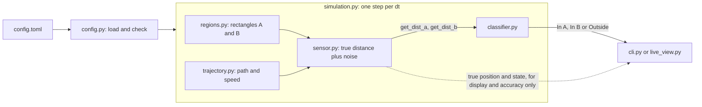
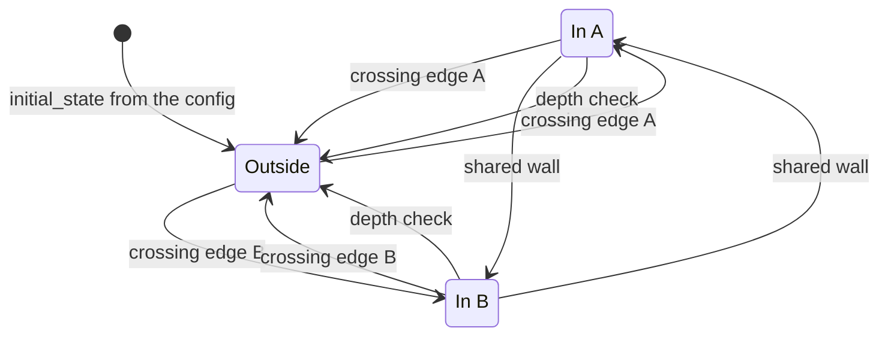

# region-presence

[](https://github.com/evg-g/region-presence/actions/workflows/ci.yml)

A small Python project that tells, in real time, whether a moving GPS sensor is
**In A**, **In B** or **Outside**. The only input is two functions,
`get_dist_a()` and `get_dist_b()`, that return the shortest distance from the
sensor to the edge of region A and region B.

The project includes a simulator (the sensor moves along a path at a changing
speed and the distance readings are noisy) and a live view.


## What you need

* **Python 3.11 or newer.** Check with `python3 --version`.
* **git**, to download the project. Or use the green "Code" button on GitHub and
  "Download ZIP".
* **Internet access** the first time, so `pip` can install the dependencies.
* **For the live view only:** a screen. On a server, or in WSL without graphics
  support, use `--headless` instead.

The project is tested on Linux (Ubuntu) with Python 3.11 to 3.14. It is plain
Python, so macOS and Windows should work too; on Windows, activate the virtual
environment with `.venv\Scripts\activate` instead of `source .venv/bin/activate`,
and type `python` where the commands say `python3`.

## Quick start

```bash
git clone https://github.com/evg-g/region-presence.git
cd region-presence
python3 -m venv .venv && source .venv/bin/activate
pip install -e ".[gui]"       # matplotlib is only needed for the live view

region-presence               # live view, default scenario, 5x real time
region-presence --headless    # text output only, no matplotlib needed
```

Other scenarios:

```bash
region-presence -c examples/shared_wall.toml     # A and B share a whole wall
region-presence -c examples/partial_wall.toml    # A and B share part of a wall
region-presence -c examples/noisy_rotated.toml   # rotated rectangles, more sensor noise
```

Useful options: `--speedup N` (0 runs as fast as possible), `--duration S`,
`--seed N`, `--verbose` (print every sample).
`python -m region_presence` works the same way.

## How it works

A distance reading has no sign. The sensor can be 3 m from the edge of A while
inside A or while outside it, and one reading cannot tell which. So the
classifier does not look at a single reading. It watches for the moment the
sensor **crosses an edge**, and switches state when that happens.

**Detecting a crossing.** Between two readings the sensor moves at most
`v_max * dt` (top speed times the time between readings). If it crossed the edge
in that time, it first covered `d_prev` to reach the edge and then `d_cur` to
move away from it. So a crossing is only possible when

```
d_prev + d_cur <= L        where  L = v_max * dt + 2 * k * noise
```

The second part of `L` is a margin for sensor noise (`k = 3` by default).
With the default settings `L = 3 * 0.1 + 2 * 3 * 0.05 = 0.6 m`.
The full calculation, with a reading-by-reading example, is in
[`docs/algorithm.md`](docs/algorithm.md).

When the test passes, the crossing is marked as possible. It is confirmed when
the distance starts growing again (the sensor is moving away from the edge), or
when the distance goes back above `L`. Then the state flips:
Outside <-> In A, or Outside <-> In B. After a crossing, the same edge cannot
trigger again until the distance has gone back above `L`, so one crossing is
never counted twice.

Each decision uses only the current and the previous reading. Nothing is
corrected afterwards. At walking speed the indication comes about one reading
(0.1 s) after the real crossing. A slow sensor is indicated a little early
(see Limitations).

**Shared wall.** If A and B touch, both distances drop to about zero at the
same moment. The classifier treats this as one crossing and moves straight from
A to B (or back) without passing through Outside.

**Depth check.** A rectangle has a largest possible distance to its own edge:
half of its shorter side (8 m for the default A, which is 20 x 16). If the state
is "In A" but `get_dist_a()` is more than that depth plus `L` (8.6 m), the sensor
cannot be inside, so the state must be wrong. The classifier goes back to Outside
and logs a warning. This is the only way a wrong state can correct itself, since
distances have no sign. It needs the two depths, which the simulation passes in;
without them the check is skipped.





## Assumptions

The assignment leaves a few things open. These are the choices made here:

1. **Distances are never negative.** If the real sensor returned a signed distance
   (negative inside), the problem would reduce to checking the sign. This is not just
   assumed: every reading is checked, and a negative, infinite or non-numeric value
   (text such as `"3.5"` and `True`/`False` included) stops the classifier with an
   `InvalidReadingError` that names the function and the value. The state is not
   changed by a bad reading.
2. **The starting state is known.** It is set in the config
   (`simulation.initial_state`, default `outside`). The simulator checks that it
   matches where the path really starts. The classifier never sees the true position.
3. **A and B are rectangles that do not overlap** (confirmed with the interviewer).
   Each one can be rotated (`rotation_deg`, default 0). They may be apart, share a
   whole wall or share part of a wall; see
   [`docs/algorithm.md`](docs/algorithm.md#7-region-layouts) and the files in
   [`examples/`](examples/).
4. **The sensor moves freely in the plane.** It can curve and turn back; left to right
   is just one possible path.
5. **Top speed and sensor noise are known** (`max_speed`, `noise_std` in the config).
   Speed, noise and sample rate have no values in the assignment. The defaults
   (walking speed 1.4 m/s, 5 cm noise, 10 readings per second) are my choices.
   Each region must be deeper than `L` (half of its shorter side larger than `L`),
   otherwise the exit could never be seen; such a config is rejected.

## Limitations

These come from the problem itself (an unsigned distance) and from using only the
current and the previous reading. Two reviewers found most of them, and I repeated
the experiments behind the numbers below. The first two are covered by tests in
[`tests/test_classifier.py`](tests/test_classifier.py), marked as expected failures.

* **Standing still, sliding along an edge, or touching it and turning back** within
  about 0.3 m of the edge looks like a crossing, and the state flips wrongly. The
  depth check corrects it only after the sensor has moved far from the region. I
  measured 100 of 100 runs wrong after idling 0.15 m from an edge, and 0 of 100
  still wrong after walking 40 m away.
* **A pass shallower than `L`** (into a corner and straight out again) ends in the
  wrong state, for the same reason, and is corrected the same way.
* **A false "Outside" while really inside** cannot be detected: a distance below the
  region's depth fits both states.
* **A slow sensor is indicated early.** The flip comes before the edge by about
  0.3 m at 0.05 m/s and 0.2 m at 0.4 m/s. At about 0.8 m/s it is on time, and
  above that it is late (about 0.13 m at 1.4 m/s).
* **A gap between A and B smaller than about `L`** (0.6 m by default) is read as a
  shared wall, so no Outside appears between them.
* **Real GPS noise is much larger than 5 cm.** `L` grows with the noise, and so does
  the delay. With the default scenario and noise of 0.2 m the state sequence is
  right in 30 of 30 runs (98.6% of readings correct); at 0.5 m in 27 of 30
  (95.4%); at 1 m in 15 of 30 (89.4%). With noise of 2 m, `L` is larger than the
  regions and the config is rejected.
* **The sample interval is fixed.** `update()` has no timestamp, so dropped or late
  samples break the calculation of `L`.
* **A speed above `max_speed`** can make the sensor skip over a crossing.
* **After an invalid reading** the next valid one is compared with the last valid one as
  if only one sample had passed, although the gap may be longer.

## Accuracy

Over 100 seeds per scenario, the indication matches the true state on these shares
of readings. The misses are the short delays right after each crossing. The last
column counts the runs where the list of state changes was exactly the true one.

| Scenario | Mean | Worst run | Correct sequence |
|---|---|---|---|
| default | 99.75% | 99.33% | 100 of 100 |
| `shared_wall` | 99.65% | 98.69% | 100 of 100 |
| `partial_wall` | 99.67% | 98.91% | 100 of 100 |
| `noisy_rotated` | 99.19% | 97.92% | 99 of 100 |

The simulator uses the same top speed and noise as the classifier assumes, so these
are best-case numbers inside the limits above.

## Simulation

* **Path:** a smooth curve through a list of points from the config, open or closed.
* **Speed:** has a configured average but keeps changing. It drifts up and down
  around the average (an Ornstein-Uhlenbeck process) and stays between
  `min_speed` and `max_speed`, so the sensor speeds up, slows down and sometimes stops.
* **Readings:** `get_dist_a()` and `get_dist_b()` take no arguments, like a real
  sensor driver. Each returns the true distance plus random noise, never below 0.
  The true position is used only for the display and for measuring accuracy.
* **Display:** a map with both regions, the current state in large colored text,
  the true state next to it for comparison, and a plot of the two distances with
  the line `L`.

## Configuration

Everything is set in a TOML file, with no code changes. See
[`src/region_presence/default_config.toml`](src/region_presence/default_config.toml)
and the files in [`examples/`](examples/).

| Section | Keys |
|---|---|
| `[simulation]` | `duration_s`, `dt`, `seed`, `initial_state` (`outside`, `in_a`, `in_b`) |
| `[sensor]` | `noise_std`, `sigma_multiplier` |
| `[motion]` | `mean_speed`, `speed_std`, `correlation_time`, `min_speed`, `max_speed` |
| `[path]` | `points` (list of `[x, y]`), `closed` |
| `[regions.A]`, `[regions.B]` | `center`, `width`, `height`, `rotation_deg` (optional, degrees counter-clockwise) |

The speed is clipped to `[min_speed, max_speed]`, which pulls the real average away from
`mean_speed` when that is close to a limit: 1.4 gives about 1.42, but 0.5 gives about 0.63.

The file is checked before anything runs. A mistake gives one line that names the
file, the section, the key and the value, for example
`error: my.toml: [regions.A] width = '20': expected a number`, and exit code 2.

## Using the classifier on its own

The classifier only needs the two distance functions:

```python
from region_presence import ClassifierConfig, PresenceClassifier

cfg = ClassifierConfig.from_motion(max_speed=3.0, dt=0.1, noise_std=0.05)
clf = PresenceClassifier(sensor.get_dist_a, sensor.get_dist_b, cfg)

# call once per new reading:
print(clf.update().state)    # Presence.IN_A, Presence.IN_B or Presence.OUTSIDE
```

`update()` raises `InvalidReadingError` (a `ValueError`) if a distance function returns
a negative, infinite or non-numeric value (text and `True`/`False` included).

## Project layout

```
src/region_presence/
  classifier.py   the algorithm; uses only the two distance functions
  regions.py      rectangles (optionally rotated) and the overlap check
  trajectory.py   the path and the changing speed
  sensor.py       simulated sensor with get_dist_a() / get_dist_b()
  simulation.py   connects the parts and measures accuracy
  config.py       loads and checks the TOML file
  live_view.py    the live plot
  cli.py          command line
tests/            124 tests (3 are expected failures that document the limitations)
examples/         extra scenarios
```

## Possible improvements

Left out on purpose: they change the core of the algorithm, the task has only two
regions, and I preferred not to risk the part that works and is well tested.

* One small state object per region instead of three dictionaries keyed by `"A"`
  and `"B"`. Adding a third region would then not need a rewrite of the crossing logic.
* The shared-wall rule as a separate policy, not part of the main state machine.
* A `Region` protocol (`distance_to_boundary`, `contains`), so other shapes need no
  change in the classifier or the sensor.
* Dependency injection in `Simulation`, so another sensor or classifier can be tested.
* Splitting `run_gui` into smaller functions.
* A `Trajectory` protocol, so a recorded GPS track can replace the generated path.
* Clearer diagnostics: a sample index or time in `InvalidReadingError` and in the
  "missed exit" warning, which should also be rate limited.
* `Simulation.frames()` is not safe to iterate twice (metrics are counted again), and one
  random generator feeds both speed and noise, so seeded runs change when either is changed.
* More automatic checks: a CI job that builds the wheel and runs it in a clean environment,
  a coverage threshold, `pre-commit`, a lock file, a property-based test (Hypothesis), and
  journey scenarios as TOML files driven by `pytest.mark.parametrize`.
* Timestamps in `update()`, so `L` is calculated from the real time between samples.
* `asyncio`, if the sensor becomes a network device or there are several sensors.
* Vectorising with NumPy, for batch work such as replaying long recordings.

## Development

```bash
pip install -e ".[dev]"
pytest
ruff check src tests
mypy src
```

The same checks run on GitHub for Python 3.11 to 3.14 on every push and pull request.
