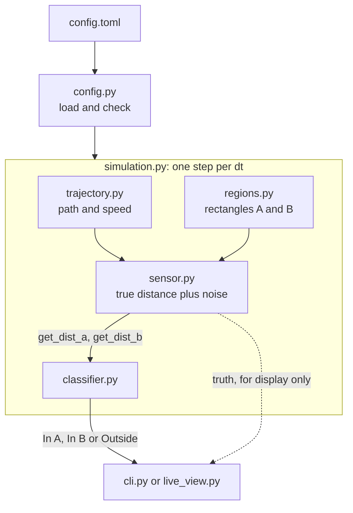
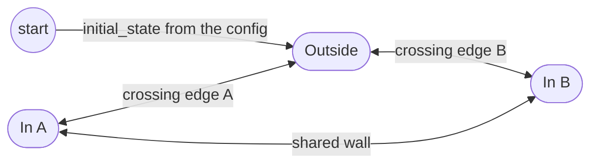

# region-presence

[](https://github.com/evg-g/region-presence/actions/workflows/ci.yml)

A small Python project that tells, in real time, whether a moving GPS sensor is
**In A**, **In B** or **Outside**. The only input is two functions,
`get_dist_a()` and `get_dist_b()`, that return the shortest distance from the
sensor to the edge of region A and region B.

The project includes a simulator (the sensor moves along a path at a changing
speed and the distance readings are noisy) and a live view.


## What you need

* **Python 3.11 or newer** (`python3 --version`) and **git**, or "Download ZIP" on GitHub.
* **Internet** the first time, so `pip` can install the dependencies.
* **For the live view only:** a screen. On a server, or in WSL without graphics, use `--headless`.

Tested on Linux (Ubuntu) with Python 3.11 to 3.14. macOS and Windows should work too; on
Windows, activate the environment with `.venv\Scripts\activate` and type `python` for `python3`.

## Quick start

```bash
git clone https://github.com/evg-g/region-presence.git
cd region-presence
python3 -m venv .venv && source .venv/bin/activate
pip install -e ".[gui]"       # matplotlib is only needed for the live view

region-presence               # live view, default scenario, 5x real time
region-presence --headless    # text output only, no matplotlib needed
```

Other scenarios:

```bash
region-presence -c examples/shared_wall.toml     # A and B share a whole wall
region-presence -c examples/partial_wall.toml    # A and B share part of a wall
region-presence -c examples/noisy_rotated.toml   # rotated rectangles, more sensor noise
```

Useful options: `--speedup N` (0 runs as fast as possible), `--duration S`,
`--seed N`, `--verbose` (print every sample).
`python -m region_presence` works the same way.

## How it works

A distance reading has no sign. The sensor can be 3 m from the edge of A while
inside A or while outside it, and one reading cannot tell which. So the
classifier does not look at a single reading. It watches for the moment the
sensor **crosses an edge**, and switches state when that happens.

**Detecting a crossing.** Between two readings the sensor moves at most
`v_max * dt` (top speed times the time between readings). If it crossed the edge
in that time, it first covered `d_prev` to reach the edge and then `d_cur` to
move away from it. So a crossing is only possible when

```
d_prev + d_cur <= L        where  L = v_max * dt + 2 * k * noise
```

The second part of `L` is a margin for sensor noise (`k = 3` by default).
With the default settings `L = 3 * 0.1 + 2 * 3 * 0.05 = 0.6 m`.
The full calculation, with a reading-by-reading example, is in
[`docs/algorithm.md`](docs/algorithm.md).

When the test passes, the crossing is marked as possible. It is confirmed when
the distance starts growing again (the sensor is moving away from the edge), or
when the distance goes back above `L`. Then the state flips:
Outside <-> In A, or Outside <-> In B. After a crossing, the same edge cannot
trigger again until the distance has gone back above `L`, so one crossing is
never counted twice.

Each decision uses only the current and the previous reading. Nothing is
corrected afterwards. At walking speed the indication comes about one reading
(0.1 s) after the real crossing. A slow sensor is indicated a little early
(see Limitations).

**Shared wall.** If A and B touch, both distances drop to about zero at the
same moment. The classifier treats this as one crossing and moves straight from
A to B (or back) without passing through Outside.

**Depth check.** A rectangle has a largest possible distance to its own edge:
half of its shorter side (8 m for the default A, which is 20 x 16). If the state
is "In A" but `get_dist_a()` is more than that depth plus `L` (8.6 m), the sensor
cannot be inside, so the state must be wrong. The classifier goes back to Outside
and logs a warning. This is the only way a wrong state can correct itself, since
distances have no sign. It needs the two depths, which the simulation passes in;
without them the check is skipped.





The depth check is one more way back to Outside, from In A or In B.

## Assumptions

The assignment leaves a few things open. These are the choices made here:

1. **Distances are never negative.** With a signed distance the problem would reduce to
   checking the sign. Every reading is checked: a negative, infinite or non-numeric value
   (text such as `"3.5"` included) raises `InvalidReadingError` and leaves the state unchanged.
2. **The starting state is known.** It is set in the config (`simulation.initial_state`,
   default `outside`). The simulator checks it against where the path starts. The classifier
   never sees the true position.
3. **A and B are rectangles that do not overlap** (confirmed with the interviewer), and each
   may be rotated. They may be apart or share a whole or partial wall (see
   [`docs/algorithm.md`](docs/algorithm.md#7-region-layouts) and [`examples/`](examples/)).
4. **The sensor moves freely in the plane.** It can curve and turn back.
5. **Top speed and sensor noise are known** (`max_speed`, `noise_std`). The assignment gives
   no values; the defaults (1.4 m/s, 5 cm, 10 readings per second) are my choices. Each
   region must be deeper than `L`, otherwise its exit could never be seen, and such a config
   is rejected.

## Limitations

An unsigned distance cannot say which side of an edge the sensor is on, so some cases cannot
be solved. The main ones:

* **Standing still, sliding along an edge, or touching it and turning back** within about
  0.3 m of the edge looks like a crossing, and the state flips wrongly. The depth check
  corrects it only after the sensor has moved far from the region. Tests mark these as
  expected failures.
* **A false "Outside" while really inside** cannot be detected.
* **A slow sensor is indicated a little early**, and a gap between A and B smaller than
  about `L` is read as a shared wall.
* **Real GPS noise is much larger than 5 cm.** `L` grows with the noise, and so does the
  delay. At 1 m of noise the state sequence is right in only half of the runs.

The full list, with the measurements, is in [`docs/limitations.md`](docs/limitations.md).

## Accuracy

Over 100 seeds per scenario, the indication matches the true state on 99.2% to 99.8% of
readings on average (worst single run 97.9%). The state changes were exactly the true ones
in 399 of 400 runs. The misses are the short delays right after each crossing. These are
best-case numbers: the simulator uses the same top speed and noise as the classifier
assumes. The table is in [`docs/limitations.md`](docs/limitations.md#accuracy). To repeat
the measurements, run `python scripts/run_experiments.py` (about 15 seconds).

## Simulation

The sensor follows a smooth path through the points in the config. Its speed has a set average
but keeps changing (an Ornstein-Uhlenbeck process, kept between `min_speed` and `max_speed`),
so it speeds up, slows down and sometimes stops. `get_dist_a()` and `get_dist_b()` take no
arguments, like a real sensor driver, and return the true distance plus noise. The true
position is used only for the display and for measuring accuracy.

## Configuration

Everything is set in a TOML file, with no code changes. See
[`src/region_presence/default_config.toml`](src/region_presence/default_config.toml)
and the files in [`examples/`](examples/).

| Section | Keys |
|---|---|
| `[simulation]` | `duration_s`, `dt`, `seed`, `initial_state` (`outside`, `in_a`, `in_b`) |
| `[sensor]` | `noise_std`, `sigma_multiplier` |
| `[motion]` | `mean_speed`, `speed_std`, `correlation_time`, `min_speed`, `max_speed` |
| `[path]` | `points` (list of `[x, y]`), `closed` |
| `[regions.A]`, `[regions.B]` | `center`, `width`, `height`, `rotation_deg` (optional, degrees counter-clockwise) |

The speed is clipped to `[min_speed, max_speed]`, which moves the real average away from
`mean_speed` near a limit (1.4 gives about 1.42, 0.5 gives about 0.63). The file is checked
before anything runs; a mistake gives one line with the file, section, key and value, and
exit code 2.

## Using the classifier on its own

The classifier only needs the two distance functions:

```python
from region_presence import ClassifierConfig, PresenceClassifier

cfg = ClassifierConfig.from_motion(max_speed=3.0, dt=0.1, noise_std=0.05)
clf = PresenceClassifier(sensor.get_dist_a, sensor.get_dist_b, cfg)

# call once per new reading:
print(clf.update().state)    # Presence.IN_A, Presence.IN_B or Presence.OUTSIDE
```

`update()` raises `InvalidReadingError` (a `ValueError`) if a distance function returns
a negative, infinite or non-numeric value (text and `True`/`False` included).

## Project layout

```
src/region_presence/
  classifier.py   the algorithm; uses only the two distance functions
  regions.py      rectangles (optionally rotated) and the overlap check
  trajectory.py   the path and the changing speed
  sensor.py       simulated sensor with get_dist_a() / get_dist_b()
  simulation.py   connects the parts and measures accuracy
  config.py       loads and checks the TOML file
  live_view.py    the live plot
  cli.py          command line
tests/            geometry, speed, classifier, config, full runs, command line
examples/         extra scenarios
```

## Possible improvements

Left out on purpose: they change the core of the algorithm, the task has only two regions,
and I preferred not to risk the part that works and is well tested.

* **Structure:** one small state object per region instead of three dictionaries, the
  shared-wall rule as a separate policy, a `Region` protocol so other shapes need no change
  in the classifier, dependency injection in `Simulation`, and a smaller `run_gui`.
* **Behaviour:** timestamps in `update()`, so `L` follows the real time between samples.
* **Scale:** `asyncio` for a network sensor or several sensors, NumPy for batch work.
* **Checks:** a CI job that builds the wheel, a coverage threshold, a property-based test.

The complete list is in [`docs/limitations.md`](docs/limitations.md#possible-improvements).

## Development

```bash
pip install -e ".[dev]"
pytest
ruff check src tests
mypy src
```

The same checks run on GitHub for Python 3.11 to 3.14 on every push and pull request.
