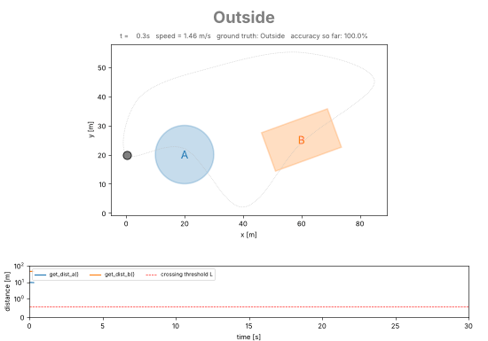

# region-presence

Real-time classification of a moving sensor as **In A / In B / Outside**, using only
two zero-argument functions: `get_dist_a()` and `get_dist_b()` (shortest distance to
the boundary of region A / B). Includes a simulator (non-constant speed, noisy
readings, configurable region shapes) and a live view.



## Quick start

```bash
pip install -e ".[gui]"          # core has no dependencies; matplotlib only for the live plot
region-presence                  # live plot, bundled scenario, 5x real time
region-presence --headless -v    # console only (stdlib only), every sample
region-presence -c examples/blobs.toml --speedup 10
region-presence -c examples/shared_wall.toml   # A and B share part of a wall: Out | A | B | Out
region-presence --save docs/demo.gif --duration 70
```

`python -m region_presence ...` works too. Options: `--config`, `--headless`, `--speedup`
(0 = as fast as possible), `--duration`, `--seed`, `--save`, `--verbose`.

## The problem, and the algorithm

The readings are **unsigned** distances, so one sample cannot tell inside from
outside. The classifier therefore detects *boundary crossings* and toggles state.

Between consecutive samples the sensor moves at most `v_max * dt`. If it crossed the
boundary of region R in that interval it travelled at least `d_prev` (to reach the
boundary) plus `d_cur` (to leave it), so

    d_prev + d_cur  <=  L,    L = v_max * dt + 2 * k * sigma

(`sigma` = sensor noise, `k` = 3 by default). When this holds the crossing is
*possible*; it is declared as soon as the distance turns upward (the sensor is moving
away from the boundary) or, if it never does, when it leaves the `L` zone. The state
then toggles `Outside <-> In R`. A per-region latch stops one crossing from firing
twice. Each decision uses only the current and previous sample: **no look-ahead, no
post-processing**; the indication lags a crossing by about one sample.

Self-healing: a distance larger than the deepest point of region R (plus `L`) proves
the sensor is not in R, which corrects a missed or spurious crossing.

### Assumptions (the brief leaves these open)

1. **Distances are absolute (never negative)**: `get_dist_a()` / `get_dist_b()` give the shortest
   distance to the region's boundary with no inside/outside sign. If the real sensor were
   signed, classification would reduce to checking the sign.
2. **The starting side is known**: `simulation.initial_state` in the config (default `outside`) is handed to the classifier. The simulator checks it matches where the path really starts and refuses to run otherwise; the classifier itself never sees ground truth.
3. **A and B are bounded rectangles with non-overlapping interiors** (confirmed with the interviewer; other shapes are supported as extras). They may be separated by a gap
   (`Out -> A -> Out -> B -> Out`, the default scenario) or share a boundary
   (`Out -> A -> B -> Out`, `examples/shared_wall.toml`).
4. **Motion is free in the 2D plane** (a left-to-right layout is just one configurable scenario);
   the sensor may curve and even double back.
5. The sensor noise and the maximum speed are bounded and known (`noise_std`, `max_speed`).

### Limitations

* A *touch-and-return* (reaching the boundary within noise and turning back without
  crossing) is indistinguishable from a crossing in distance data alone and is treated as
  one. The self-healing bound limits how long such an error can persist.
* If the real speed exceeds `max_speed`, crossings can be missed.
* With a shared boundary, the right half of A and the left half of B give identical readings
  (`d_a == d_b`); only the history tells them apart, which is why the classifier keeps state.

## Simulation

* **Motion**: a parametric path (closed Catmull-Rom spline through waypoints, or a
  Lissajous curve) traversed at a speed from an Ornstein-Uhlenbeck process: mean speed,
  std-dev and correlation time are configurable, clipped to `[min_speed, max_speed]`, so
  the sensor accelerates, slows and occasionally pauses.
* **Sensor**: `SimulatedSensor.get_dist_a()/get_dist_b()` take no arguments and return the
  current sample (true distance + Gaussian noise, floored at 0). Ground truth
  exists only for display and metrics; the classifier never sees it.
* **Display**: the map, a large colour-coded indication, the ground truth for comparison
  and the two distance signals with the threshold `L`.

## Configuration (TOML, no code edits)

See [`src/region_presence/default_config.toml`](src/region_presence/default_config.toml)
and [`examples/blobs.toml`](examples/blobs.toml).

| Section | Keys |
|---|---|
| `[simulation]` | `duration_s`, `dt`, `seed`, `initial_state` |
| `[sensor]` | `noise_std`, `sigma_multiplier` |
| `[motion]` | `mean_speed`, `speed_std`, `correlation_time`, `min_speed`, `max_speed` |
| `[path]` | `kind = "waypoints"` (`points`, `closed`) or `"lissajous"` (`center`, `amplitude`, `freq`, `phase`) |
| `[regions.A]`, `[regions.B]` | `shape = "circle"` (`center`, `radius`), `"rectangle"` (`center`, `width`, `height`, `rotation_deg`), `"ellipse"` (`center`, `rx`, `ry`, `rotation_deg`, `segments`), `"polygon"` (`vertices`, concave allowed) |

Unknown keys, missing keys, overlapping regions and bad values fail fast with a clear message.

## Use the classifier on its own

```python
from region_presence import ClassifierConfig, PresenceClassifier

cfg = ClassifierConfig.from_motion(max_speed=3.0, dt=0.1, noise_std=0.05)
clf = PresenceClassifier(sensor.get_dist_a, sensor.get_dist_b, cfg)
while True:
    sensor.read_next_sample()
    print(clf.update().state)      # Presence.IN_A / IN_B / OUTSIDE
```

## Project layout

```
src/region_presence/
  classifier.py   the algorithm (pure, depends only on the two callables)
  regions.py      circle / rectangle / ellipse / polygon geometry
  trajectory.py   parametric paths + speed process
  sensor.py       simulated sensor with get_dist_a()/get_dist_b()
  simulation.py   wiring, frames, accuracy metrics
  config.py       TOML loading and validation
  live_view.py, cli.py live plot and command line
tests/            52 tests: geometry, motion statistics, classifier logic, end-to-end, CLI
```

## Development

```bash
pip install -e ".[dev]"
pytest && ruff check src tests && mypy src
```

On the bundled scenario the indication agrees with ground truth on ~99.7% of samples
(the rest is the one-sample lag at each crossing), with no flicker and no missed crossing.
